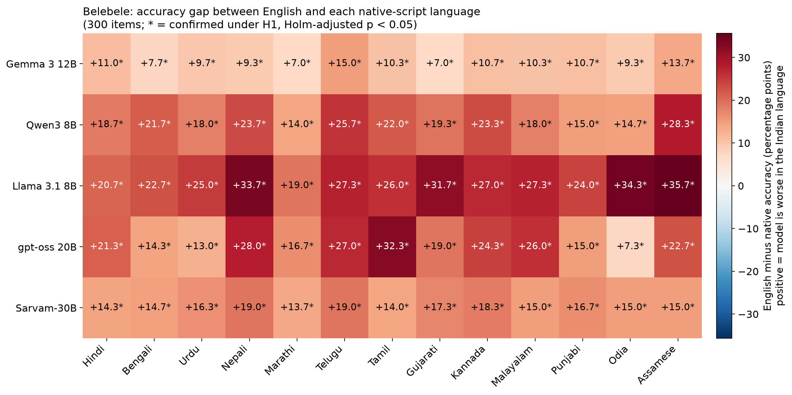
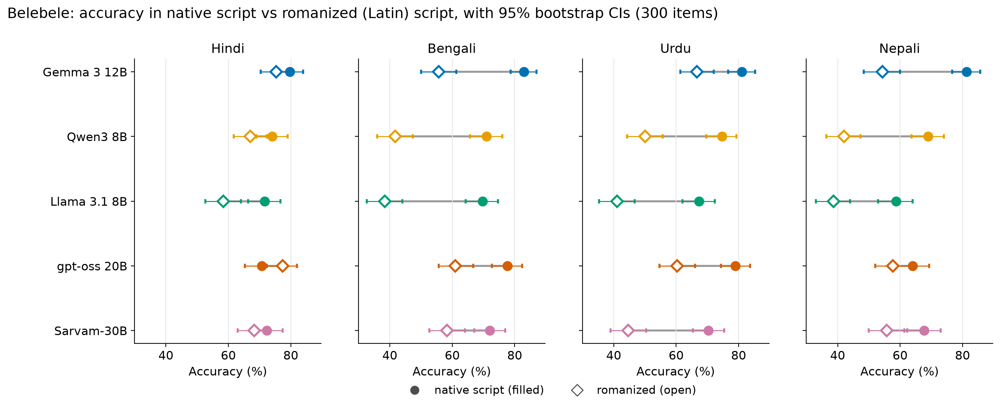
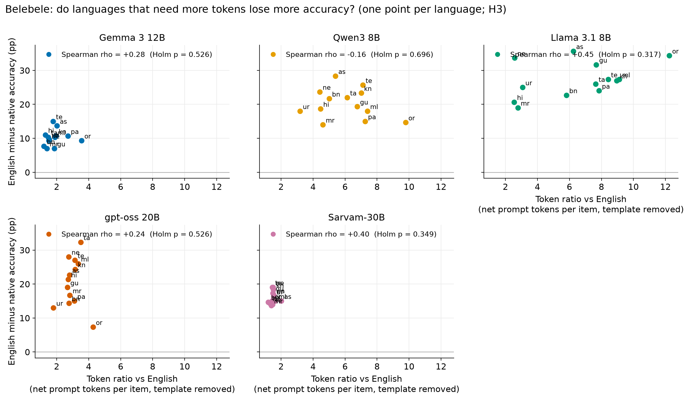
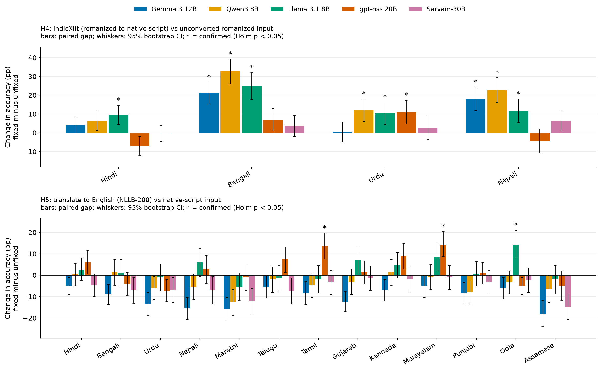
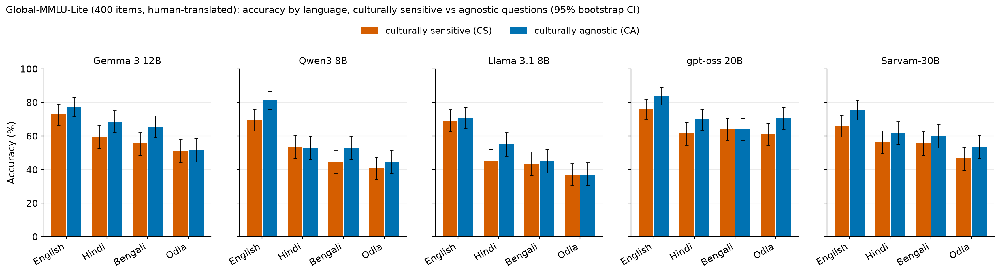
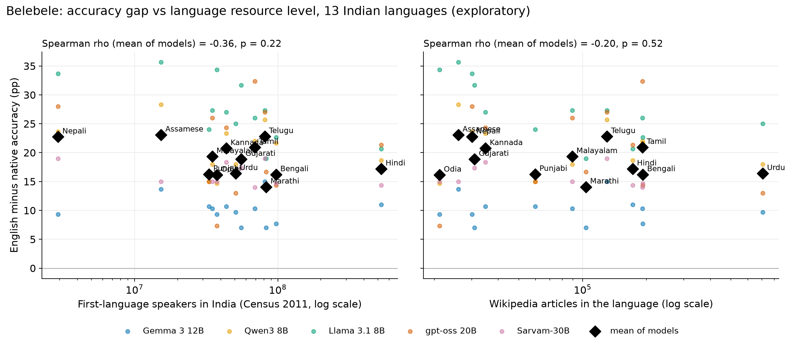

# Language and Script Gaps in Local Language Models for Indian Users

**Om Dorkar**, Delhi Public School Harni, Vadodara

## Abstract

Many Indian users write to AI systems in an Indian language, often in Latin letters. I tested whether five openly released language models, run fully offline on one laptop, answer the same question less accurately in an Indian language or in romanized script (an Indian language written in Latin letters), and whether two simple fixes help. I used 300 parallel Belebele reading-comprehension questions in English and 13 Indian languages (four also romanized), collecting 76,400 answers in total, including Global-MMLU knowledge questions and a compression check. I tested five hypotheses (H1–H5) with exact McNemar tests and Holm correction for multiple testing. Accuracy was significantly lower than in English in all 65 model–language pairs (H1; gaps 7.0 to 35.7 percentage points (pp), mean 18.8 pp). Romanized input was significantly less accurate than native script in 15 of 20 pairs (H2; up to 31.3 pp), with Hindi the main exception. A language's token ratio relative to English was not significantly associated with its accuracy gap for any model (H3; 0 of 5). Converting romanized text to native script with IndicXlit raised accuracy significantly in 10 of 20 pairs (H4; up to 32.7 pp). Translating to English with NLLB-200 (1.3B) before answering helped significantly in only 3 of 65 pairs and lowered accuracy significantly in 9 (H5). Exploratory analyses found similar gaps on Global-MMLU, small drops for machine-made Indian English, and smaller but substantial gaps for an India-built model (Sarvam-30B). Results apply to compressed models, one task format and these specific fixes.

## 1. Introduction

India has 22 scheduled languages, and the text people type to a computer is often not in the standard written form of any one of them. Many people write Hindi, Bengali, Urdu or Nepali in Latin letters ("romanized" text), mix English words into Hindi ("Hinglish"), or write English with Indian grammatical features. If an AI assistant answers a question correctly in standard English but less often when the same question is asked in Hindi, in romanized Bengali or in Hinglish, then people who write in those forms receive a worse service for a reason that has nothing to do with what they asked.

Earlier work found that language models can answer less accurately for users who appear to have lower English proficiency or to come from outside the US (Poole-Dayan et al., 2026), and that they judge people who write in a stigmatized dialect more negatively (Hofmann et al., 2024). Language and script are among the most visible signals of who is asking.

This matters more as models move onto personal devices. "Open-weight" models, whose files are released openly, can run on a laptop or phone offline, at no cost per question and without sending user data anywhere. They are usually compressed to fit in memory, and their behaviour on Indian languages is less well documented than that of large cloud systems.

This paper asks one question in several forms: **for the same multiple-choice question, does a local model answer less accurately when the question is in an Indian language, in romanized script, or in an Indian style of English or Hinglish, and can simple preprocessing on the same device reduce the gap?** I tested five hypotheses (H1–H5), defined in Section 3.6.

The study compares five open-weight models, including the India-built Sarvam-30B, run fully offline on one laptop on the same 300 questions in English, 13 Indian languages in native script and four languages in romanized script (76,400 answers in total across all conditions and benchmarks). It tests two fixes that run on the device, adds exploratory analyses (machine-made Indian English and Hinglish, knowledge questions, a compression check and a look at the India-built model), and releases the code, item lists, machine-made question versions and all model answers. All five hypotheses are reported whether or not the data support them. Two were not supported: token cost did not predict the gap (H3), and translating to English mostly did not help (H5).

## 2. Related work

**Multilingual evaluation.** Belebele (Bandarkar et al., 2024) is a reading-comprehension benchmark built on FLORES-200 passages (Goyal et al., 2022; NLLB Team et al., 2022), with the same 900 questions in 122 language variants, which allows paired comparisons across languages. Global-MMLU (Singh et al., 2025) translates the MMLU knowledge test into 42 languages, labels each question as culturally sensitive (CS) or culturally agnostic (CA), and offers a human-translated "Lite" subset. Other Indian-language benchmarks include MILU (Verma et al., 2025), written originally in 11 Indian languages, and IndicSafe (Pattnayak and Chowdhuri, 2026), which tests safety behaviour in 12 Indic languages. MEGA (Ahuja et al., 2023) found large gaps for lower-resource languages and non-Latin scripts.

**Romanized input.** Dakshina (Roark et al., 2020) collects South Asian languages written in Latin script, and Aksharantar (Madhani et al., 2023) released transliteration data and the IndicXlit model used here. Belebele's romanized versions were made by annotators with IndicXlit support, and its authors found higher accuracy in native than in Latin script for all the models they tested except Falcon (Bandarkar et al., 2024). RomanSetu (Husain et al., 2024) instead used romanization to extend English-centred models to Indian languages.

**Code-mixing.** Mixing Hindi and English in one sentence ("code-mixing") is common in Indian digital communication; GLUECoS (Khanuja et al., 2020) is a benchmark for it. The Code-Mixing Index (CMI) of Das and Gambäck (2014) scores how mixed a sentence is, with higher meaning more mixed. Synthetic code-mixed text is often made from parallel sentences using linguistic rules about where speakers switch languages (Poplack, 1980; Pratapa et al., 2018), for example with the GCM toolkit (Rizvi et al., 2021). COMI-LINGUA (Sheth et al., 2025) provides expert-annotated Hinglish.

**Dialects.** VALUE (Ziems et al., 2022) and Multi-VALUE (Ziems et al., 2023) rewrite standard English into synthetic dialects using grammatical features recorded in eWAVE, the electronic World Atlas of Varieties of English (Kortmann et al., 2020), and found performance drops on dialect input.

**Token cost ("token tax").** Models read text as tokens, small pieces of text that are often parts of words. The same sentence can need many more tokens in some languages than in others (Petrov et al., 2023), which raises cost and delay (Ahia et al., 2023). Whether it also goes with lower accuracy is tested here as H3.

**Translate-test.** Translating input into English before answering is an old baseline that has been revisited with better translation systems (Artetxe et al., 2023), and Etxaniz et al. (2024) found that having a model translate its own input into English can improve results. I test the simplest on-device version, a separate open translation model (NLLB-200), because the stronger Indian-language system IndicTrans2 (Gala et al., 2023) requires an access request.

## 3. Methods

### 3.1 Data and sampling

**Belebele.** Each Belebele item is a short passage, one question about it and four answer options. The passages come from FLORES-200, a set of English news, travel and reference articles professionally translated into many languages, and every language version has the same questions and correct answers (Bandarkar et al., 2024). I used English; 13 Indian languages in their native scripts (Hindi, Bengali, Urdu, Nepali, Marathi, Telugu, Tamil, Gujarati, Kannada, Malayalam, Punjabi, Odia and Assamese); and the romanized versions of Hindi, Bengali, Urdu and Nepali. An automatic check confirmed that all these versions are exactly parallel.

Belebele has 900 questions on 488 passages. To choose 300 questions while keeping each passage's questions together, I shuffled the passages using a fixed random seed and added whole passages until exactly 300 questions were selected. The sample covers 165 passages. The same 300 questions were used in every language, condition and model; none was malformed and none was excluded.

**Global-MMLU-Lite and Global-MMLU (exploratory).** These are multiple-choice knowledge questions on school and university subjects, with no passage to read. Global-MMLU-Lite has 400 human-translated test questions (200 CS, 200 CA); I used all 400 in English, Hindi, Bengali and Odia. From the full Global-MMLU I sampled 300 test questions that exist in all of English, Hindi, Bengali, Telugu and Nepali. Global-MMLU's Telugu and Nepali versions mix machine translation and human correction, so its results are reported separately from the Lite results.

**Language statistics.** As rough measures of each language's resource level, I used speaker counts from the Census of India 2011 (as tabulated on Wikipedia) and the number of Wikipedia articles in the language, both retrieved on 2026-10-21.

### 3.2 Conditions

A "condition" is one version of the 300 questions (Table 1).

| Version of the questions | How it was made | Role |
|---|---|---|
| English | Belebele (human) | Reference for H1 |
| 13 Indian languages, native script | Belebele (human translation) | H1 |
| 4 languages, romanized | Belebele (human annotators) | H2 |
| Romanized input converted to native script (4) | IndicXlit (machine) | Fix tested by H4 |
| Native script translated to English (13) | NLLB-200 (machine) | Fix tested by H5 |
| Indian English | Multi-VALUE (machine) | Exploratory |
| Hinglish | Machine replacement of Hindi words with English ones | Exploratory |

*Table 1. Belebele conditions (300 questions each).*

Every condition kept the correct answer letter and the order of options unchanged. One feature of Belebele matters for interpretation. In its romanized versions, the *passage* is a letter-by-letter rewriting of the native passage, but the *question and options* are a separately worded, informal translation. For example, the romanized Hindi question begins "Passage ke hisab se" ("according to the passage", using the English word "passage"), while the native-script question uses the formal Hindi "परिच्छेद के अनुसार". So when romanized input is converted back to native script, the passages come out close to Belebele's native text, but the questions and options are worded differently from the native versions.

### 3.3 Models and settings

All models ran one at a time, offline, on one Apple M4 Pro MacBook laptop with 24 GB of memory, using two free programs for running models on a personal computer: Ollama (Ollama contributors, 2023) for four models and llama.cpp (Gerganov and llama.cpp contributors, 2023) for Sarvam-30B.

The number in each model's name is its size in parameters, the numbers the model learned during training (12B means about 12 billion). To fit in memory, every model was **quantized**: each parameter is stored with fewer bits, which makes the model smaller and faster at some cost in accuracy.

| Model | Developer | Compression | How it answered |
|---|---|---|---|
| Gemma 3 12B (Gemma Team, 2025) | Google | 4-bit | Directly, up to 32 tokens |
| Qwen3 8B (Yang et al., 2025) | Alibaba | 4-bit | Directly (thinking mode off), up to 32 tokens |
| Llama 3.1 8B (Grattafiori et al., 2024) | Meta | 4-bit | Directly, up to 32 tokens |
| gpt-oss 20B (OpenAI, 2025) | OpenAI | 4-bit (its own format) | Brief reasoning first, up to 512 tokens |
| Sarvam-30B (Sarvam AI, 2026) | Sarvam AI (India) | 3-bit | Directly (reasoning off), up to 32 tokens |
| Llama 3.1 8B, 3-bit control | Meta | 3-bit | Directly, up to 32 tokens |

*Table 2. Models and settings.*

Sarvam-30B is a "mixture-of-experts" model with 32B parameters in total, of which 2.4B are used for each token. Its standard 4-bit version did not fit in the laptop's memory, so I compressed it further, to a lower 3-bit setting. To estimate the effect of this step alone, I also tested Llama 3.1 8B at 3 bits as a control.

gpt-oss 20B cannot answer without first reasoning (writing out its thinking), so it was set to reason briefly and given up to 512 tokens; it is the only model that reasoned before answering.

### 3.4 Prompt, answers and scoring

Every condition used the same instruction, written in English, so that only the passage, question and options changed. It asked the model to read the passage and reply with only the letter (A, B, C or D) of its answer in a fixed simple format, and the software was set to accept only these four letters. The knowledge questions used the same style without a passage. Each model saw each question once, in shuffled order, with temperature 0 (the model always picks its most likely output, so answers are repeatable) and a fixed random seed. A reply that was not exactly one valid letter counted as wrong.

**Answer counts.** Belebele: 5 models × 37 conditions × 300 questions = 55,500, plus 5,400 for the 3-bit Llama control on the 18 human-made conditions (English, 13 native-script and 4 romanized). Global-MMLU-Lite: 5 × 4 × 400 = 8,000. Global-MMLU: 5 × 5 × 300 = 7,500. In total: 76,400 answers.

**Empty answers.** Only gpt-oss 20B ever failed to give a valid letter, always by giving an empty answer after its reasoning used up the whole 512-token allowance: 78 in all (0.10% of 76,400), 43 of them on Belebele. The highest rate in any one condition was 2.3% (Global-MMLU English); within Belebele it was 1.7%. Empty answers were counted as wrong and were not repeated.

### 3.5 The two fixes and the exploratory versions

**Transliteration fix (H4).** IndicXlit (Madhani et al., 2023), a small open model from AI4Bharat, converted the four romanized versions to native script word by word, choosing the most likely spelling for each word.

**Translation fix (H5).** NLLB-200 (NLLB Team et al., 2022), an open translation model from Meta, in its 1.3-billion-parameter version, translated the 13 native-script versions into English sentence by sentence (passage, question and each option separately), and the result was given to the answering model with the same English instruction.

**Checking the fixes.** Compared with Belebele's own native-script passages, IndicXlit's character error rate (the share of characters that differ) was 4.67% (Hindi), 4.89% (Bengali), 8.26% (Urdu) and 5.76% (Nepali). These are upper limits on the true error, because romanized text has no single correct spelling. NLLB's English was compared with Belebele's original English using chrF (Popović, 2015), a score from 0 to 100 (100 = identical) based on how many short character sequences two texts share; it ranged from 56.51 (Assamese) to 66.09 (Hindi).

**Machine-made Indian English (exploratory).** Multi-VALUE (Ziems et al., 2023) rewrites standard English by applying grammatical features recorded for Indian English. I applied it to every passage, question and option, and an automatic check undid any change that moved a text too far in meaning from the original, as judged by the LaBSE sentence-similarity model (Feng et al., 2022). In the end, 75.7% of texts and all 300 questions were changed. The check does not catch every small change of meaning: for example, the option "He was arrested at the scene" became "He have been arresting at scene".

**Machine-made Hinglish (exploratory).** Starting from Belebele's human romanized Hindi, an automatic word aligner (SimAlign; Jalili Sabet et al., 2020) found which word in the parallel English text matched each Hindi word, and single Hindi words (mainly nouns, adjectives and some common short words, never names, pronouns or numbers written as figures) were replaced with their English match until each sentence reached a mixing level drawn from real Hinglish in COMI-LINGUA. The mean CMI rose from 5.4 (plain romanized Hindi) to 19.3, against 27.8 in COMI-LINGUA, so this version is less mixed than real Hinglish. It is a simplified method in the spirit of GCM, not GCM itself.

### 3.6 Hypotheses and statistics

I tested five directional hypotheses. Each compares accuracy on the same questions and forms its own "family" of tests.

* **H1 (language gap).** Accuracy in each native-script Indian language is lower than in English. 5 models × 13 languages = 65 tests.
* **H2 (script gap).** For Hindi, Bengali, Urdu and Nepali, accuracy on romanized input is lower than on native script. 5 × 4 = 20 tests.
* **H3 (token tax).** Across the 13 languages, a higher token ratio (tokens needed relative to English for the same question) goes with a larger gap from English. One correlation per model, 5 tests.
* **H4 (transliteration fix).** Converting romanized input to native script with IndicXlit raises accuracy over unconverted romanized input. 5 × 4 = 20 tests.
* **H5 (translation fix).** Translating native-script input to English with NLLB-200 raises accuracy over untranslated native-script input. 5 × 13 = 65 tests.

The main measure is accuracy, the share of questions answered with the correct letter; gaps between two conditions are given in percentage points (pp). The statistical tools were:

* *Paired comparison.* Every condition has the same 300 questions, so conditions are compared question by question, which removes differences in question difficulty.
* *Exact McNemar test* (McNemar, 1947). It looks only at the questions answered correctly in one condition but not the other, and asks whether that split is more one-sided than chance would produce.
* *Holm correction* (Holm, 1979). When many pairs are tested, some would look significant by chance alone; Holm's method adjusts the p-values, separately within each hypothesis family, so that the chance of any false positive in the family stays below 5%.
* *Bootstrap 95% intervals* (Efron, 1979). The 300 questions were redrawn at random, with replacement, 10,000 times and the gap was recomputed each time; the middle 95% of these values is the interval. Questions, not passages, were redrawn.
* *Spearman correlation* (H3). It measures whether languages that rank higher on token ratio also rank higher on accuracy gap, giving a value ρ from −1 to +1. H3 predicted ρ > 0, tested one-sided.

A pair counts as **confirmed** only if its Holm-adjusted p-value is below 0.05 and the gap is in the predicted direction (for H3, a positive ρ). Token counts come from each model's own count and exclude the fixed instructions; a condition's token ratio is its mean count per question divided by the mean for English.

H1–H5 are the **main hypothesis tests**, and every result for them is reported, significant or not. All other results (Section 5) are **exploratory analyses**: they use the same bootstrap and McNemar test, with Holm correction only for the Global-MMLU gaps (within each benchmark). Their p-values describe the data and do not support claims of the kind made for H1–H5.

## 4. Results: main hypothesis tests (H1–H5)

English accuracy on the 300 Belebele questions was 90.7% (Gemma 3 12B), 92.7% (Qwen3 8B), 92.3% (Llama 3.1 8B), 92.0% (gpt-oss 20B) and 86.7% (Sarvam-30B). Mean native-script accuracy over the 13 languages was 80.5%, 72.5%, 65.1%, 71.5% and 70.6%, and mean romanized accuracy over the four languages was 63.0%, 50.2%, 44.1%, 64.1% and 56.8%. Table 3 summarizes the five hypotheses.

| Hypothesis | Confirmed | Not significant | Significant, opposite direction |
|---|---|---|---|
| H1 native script lower than English | **65 / 65** | 0 | 0 |
| H2 romanized lower than native script | **15 / 20** | 5 | 0 |
| H3 token ratio predicts gap | **0 / 5** | 5 | 0 |
| H4 IndicXlit raises romanized accuracy | **10 / 20** | 10 | 0 |
| H5 translation to English raises accuracy | **3 / 65** | 53 | 9 |

*Table 3. Main results (Holm-adjusted p < 0.05 within each family).*

### 4.1 H1: every Indian language was answered less accurately than English

H1 was confirmed for all 65 model–language pairs. Gaps ranged from −7.0 pp (Gemma 3 12B on Marathi and on Gujarati) to −35.7 pp (Llama 3.1 8B on Assamese); the mean over all 65 pairs was −18.8 pp, and the largest Holm-adjusted p-value was 0.001. The 95% bootstrap intervals were 7.3 to 12.0 pp wide, and every interval excluded zero (the upper limits closest to zero were −3.3 pp).

| Language | Gemma 3 12B | Qwen3 8B | Llama 3.1 8B | gpt-oss 20B | Sarvam-30B |
|---|---|---|---|---|---|
| Hindi | −11.0 | −18.7 | −20.7 | −21.3 | −14.3 |
| Bengali | −7.7 | −21.7 | −22.7 | −14.3 | −14.7 |
| Urdu | −9.7 | −18.0 | −25.0 | −13.0 | −16.3 |
| Nepali | −9.3 | −23.7 | −33.7 | −28.0 | −19.0 |
| Marathi | −7.0 | −14.0 | −19.0 | −16.7 | −13.7 |
| Telugu | −15.0 | −25.7 | −27.3 | −27.0 | −19.0 |
| Tamil | −10.3 | −22.0 | −26.0 | −32.3 | −14.0 |
| Gujarati | −7.0 | −19.3 | −31.7 | −19.0 | −17.3 |
| Kannada | −10.7 | −23.3 | −27.0 | −24.3 | −18.3 |
| Malayalam | −10.3 | −18.0 | −27.3 | −26.0 | −15.0 |
| Punjabi | −10.7 | −15.0 | −24.0 | −15.0 | −16.7 |
| Odia | −9.3 | −14.7 | −34.3 | −7.3 | −15.0 |
| Assamese | −13.7 | −28.3 | −35.7 | −22.7 | −15.0 |
| **Mean** | −10.1 | −20.2 | −27.3 | −20.5 | −16.0 |

*Table 4. H1: native-script accuracy minus English accuracy (pp), 300 paired questions per cell. All 65 confirmed.*

Mean gaps differed between models by a factor of almost three: Gemma 3 12B had the smallest (−10.1 pp) and Llama 3.1 8B the largest (−27.3 pp). The hardest language also differed by model: Assamese for Qwen3 and Llama, Tamil for gpt-oss (−32.3 pp), Telugu for Gemma (−15.0 pp), and Nepali and Telugu for Sarvam (both −19.0 pp). gpt-oss had both one of the largest gaps (Tamil) and one of the smallest (Odia, −7.3 pp).

### 4.2 H2: romanized input was usually worse than native script, except for Hindi

H2 was confirmed in 15 of 20 pairs: all five models for Bengali and for Urdu, four of five for Nepali, and one of five for Hindi (Table 5, Figure 2). The largest penalties were for Llama 3.1 8B on Bengali (−31.3 pp, 95% interval [−38.3, −24.3]) and Qwen3 8B on Bengali (−29.3 pp [−36.3, −22.7]). For Hindi, only Llama 3.1 8B showed a significant penalty (−13.3 pp [−19.3, −7.3]). gpt-oss was *more* accurate on romanized Hindi (77.3%) than on native-script Hindi (70.7%), a difference of +6.7 pp [+1.3, +12.0] that was not significant after Holm correction (adjusted p = 0.11).

| Language | Gemma 3 12B | Qwen3 8B | Llama 3.1 8B | gpt-oss 20B | Sarvam-30B |
|---|---|---|---|---|---|
| Hindi | −4.3 | −7.0 | **−13.3** | +6.7 | −4.0 |
| Bengali | **−27.3** | **−29.3** | **−31.3** | **−16.7** | **−13.7** |
| Urdu | **−14.3** | **−24.7** | **−26.3** | **−18.7** | **−25.7** |
| Nepali | **−27.0** | **−27.0** | **−20.0** | −6.3 | **−12.0** |

*Table 5. H2: romanized minus native-script accuracy (pp). Bold = confirmed.*

Two unconfirmed pairs have intervals that exclude zero (Qwen3 on Hindi, −7.0 pp [−13.3, −0.7], Holm-adjusted p = 0.15; and gpt-oss on Hindi, above). The bootstrap intervals are not corrected for testing many pairs, so the Holm-adjusted test decides confirmation. The five non-significant pairs are not evidence that no penalty exists.

### 4.3 H3: token cost did not predict the size of the gap

Token ratios varied widely between models. Relative to English, native-script questions needed 2.55 (Hindi) to 12.24 (Odia) times as many tokens for Llama 3.1 8B, 3.18 (Urdu) to 9.78 (Odia) for Qwen3 8B, 1.80 (Urdu) to 4.27 (Odia) for gpt-oss 20B, 1.20 (Bengali) to 3.56 (Odia) for Gemma 3 12B, and 1.20 (Bengali) to 2.02 (Assamese) for Sarvam-30B. Within each model, however, languages with higher token ratios did not have significantly larger gaps. The Spearman correlations across the 13 languages were ρ = +0.28 (Gemma, one-sided p = 0.175, Holm 0.526), −0.16 (Qwen3, p = 0.696, Holm 0.696), +0.45 (Llama, p = 0.063, Holm 0.317), +0.24 (gpt-oss, p = 0.213, Holm 0.526) and +0.40 (Sarvam, p = 0.087, Holm 0.349). H3 was confirmed for 0 of 5 models.

Four of the five correlations were positive, so a weak association is not ruled out: with only 13 languages per model, only fairly strong correlations can reach significance after correction. The data do not support token count as a strong predictor, within a model, of which languages lose the most accuracy.

### 4.4 H4: converting romanized text to native script often helped

H4 was confirmed in 10 of 20 pairs (Table 6, Figure 4, top). The gains were largest for Bengali (Qwen3 +32.7 pp [+26.0, +39.3]; Llama +25.0 pp; Gemma +21.0 pp) and Nepali (Qwen3 +22.7 pp; Gemma +18.0 pp; Llama +11.7 pp). For Urdu, the language with the least accurate transliteration (8.26% of characters differing), three models improved significantly (Qwen3, Llama and gpt-oss, +10.3 to +12.0 pp), while Gemma did not change (+0.3 pp). For Hindi only Llama improved significantly (+9.7 pp). By model, confirmations were 2 of 4 (Gemma), 3 of 4 (Qwen3), 4 of 4 (Llama), 1 of 4 (gpt-oss) and 0 of 4 (Sarvam). No pair was significantly worse after conversion; the largest non-significant drop was gpt-oss on Hindi (−7.0 pp, Holm-adjusted p = 0.086), the one pair in which romanized input had been more accurate than native script.

| Language | Gemma 3 12B | Qwen3 8B | Llama 3.1 8B | gpt-oss 20B | Sarvam-30B |
|---|---|---|---|---|---|
| Hindi | 79.7 / 75.3 / 79.3 | 74.0 / 67.0 / 73.3 | 71.7 / 58.3 / **68.0** | 70.7 / 77.3 / 70.3 | 72.3 / 68.3 / 68.0 |
| Bengali | 83.0 / 55.7 / **76.7** | 71.0 / 41.7 / **74.3** | 69.7 / 38.3 / **63.3** | 77.7 / 61.0 / 68.0 | 72.0 / 58.3 / 62.0 |
| Urdu | 81.0 / 66.7 / 67.0 | 74.7 / 50.0 / **62.0** | 67.3 / 41.0 / **51.3** | 79.0 / 60.3 / **71.3** | 70.3 / 44.7 / 47.3 |
| Nepali | 81.3 / 54.3 / **72.3** | 69.0 / 42.0 / **64.7** | 58.7 / 38.7 / **50.3** | 64.0 / 57.7 / 53.3 | 67.7 / 55.7 / 62.0 |

*Table 6. Accuracy (%) for native script / romanized / romanized converted to native script with IndicXlit. Bold = H4 confirmed (converted higher than romanized).*

Conversion recovered much of the romanization penalty for Bengali and Nepali. For Qwen3 on Bengali, accuracy after conversion (74.3%) was even slightly above the native-script version (71.0%). Because the converted questions and options are worded differently from the native ones (Section 3.2), the two are not the same text, and this comparison is descriptive only.

### 4.5 H5: translating to English mostly did not help, and sometimes hurt

H5 was confirmed in only 3 of 65 pairs: Llama 3.1 8B on Odia (+14.3 pp [+8.0, +21.0]), gpt-oss 20B on Tamil (+13.7 pp [+7.7, +19.7]) and gpt-oss 20B on Malayalam (+14.3 pp [+8.7, +20.3]). In 9 pairs translation made accuracy **significantly worse**: Gemma 3 12B on Bengali (−9.0 pp), Urdu (−13.3), Nepali (−15.3), Marathi (−15.7), Gujarati (−12.3) and Assamese (−18.0); Qwen3 8B on Marathi (−12.7); and Sarvam-30B on Marathi (−12.0) and Assamese (−14.7). The remaining 53 pairs were not significant in either direction (Figure 4, bottom).

| Model | Mean native acc. (%) | Mean translated acc. (%) | Mean change (pp) | Confirmed | Significant opposite |
|---|---|---|---|---|---|
| Gemma 3 12B | 80.5 | 70.6 | −9.9 | 0 | 6 |
| Qwen3 8B | 72.5 | 68.7 | −3.8 | 0 | 1 |
| Llama 3.1 8B | 65.1 | 67.6 | +2.6 | 1 | 0 |
| gpt-oss 20B | 71.5 | 74.1 | +2.6 | 2 | 0 |
| Sarvam-30B | 70.6 | 65.1 | −5.5 | 0 | 2 |

*Table 7. H5 by model, means over the 13 languages.*

The two models with a net gain (Llama and gpt-oss) include the one weakest on native-script input (Llama), while the model strongest on native-script input, Gemma 3 12B, lost accuracy in all 13 languages. Even when translation helped, translated input stayed well below English: mean translated accuracy (65.1% to 74.1%) was 17.9 to 24.7 pp below each model's English accuracy, although the translations come from passages that were originally English. Assamese, the language with the lowest translation quality (chrF 56.51), had the largest losses for Gemma (−18.0 pp) and Sarvam (−14.7 pp).

## 5. Results: exploratory analyses

None of the results in this section are among the five main hypothesis tests. They describe the data and suggest questions for future work.

**Knowledge questions.** All 15 Global-MMLU-Lite gaps (five models; Hindi, Bengali, Odia) and all 20 Global-MMLU gaps (five models; Hindi, Bengali, Telugu, Nepali) were negative and significant after Holm correction within each benchmark. On Global-MMLU-Lite they ranged from −11.2 pp (Gemma, Hindi) to −33.0 pp (Llama, Odia); on Global-MMLU from −7.3 pp (Sarvam, Hindi) to −28.7 pp (Llama, Telugu). The Belebele pattern therefore also appears on knowledge questions.

**Culturally sensitive vs agnostic questions.** On Global-MMLU-Lite, the language gap on CS questions minus the gap on CA questions ranged from −8.0 pp (Llama, Hindi) to +12.5 pp (Qwen3, Hindi) across 15 model–language pairs (Figure 5). Only one 95% interval excluded zero, Qwen3 on Hindi (+12.5 pp [+2.0, +23.0]), where CS questions lost *less*; among 15 unadjusted intervals this is about what chance alone would produce. The data therefore do not show that the gap differs between the two kinds of question. The CS/CA labels are Global-MMLU's and are not specific to India.

**Machine-made Indian English.** Compared with standard English, accuracy on the Indian English version was 1.3 to 7.3 pp lower: Gemma −3.7 pp (p = 0.035), gpt-oss −1.3 pp (p = 0.54), Llama −3.3 pp (p = 0.041), Qwen3 −2.3 pp (p = 0.092) and Sarvam −7.3 pp [−11.0, −3.7] (p = 0.0002), all unadjusted, so only the drops for Gemma, Llama and Sarvam had p below 0.05. All are much smaller than the gaps for Indian languages, and because some Multi-VALUE rules can change meaning (Section 3.5), they cannot be put down to dialect alone.

**Machine-made Hinglish.** Compared with plain romanized Hindi, the Hinglish version changed accuracy by −3.0 pp (Sarvam) to +5.0 pp (Llama, [+0.7, +9.3], unadjusted p = 0.044); the other three changes were not significant (Gemma 0.0, gpt-oss +1.0, Qwen3 +3.3). Hinglish accuracy was 13.7 pp (gpt-oss) to 29.0 pp (Llama) below English. Replacing some Hindi words with English ones therefore did not bring romanized Hindi close to English accuracy, at the (lower than natural) mixing level reached here.

**Compression check (Llama 3.1 8B, 3-bit minus 4-bit).** Over the 18 human-made Belebele conditions, the 3-bit model was 3.4 pp less accurate on average (95% interval [−4.6, −2.1]), with changes from −6.7 pp (Malayalam, Punjabi) to +1.0 pp (romanized Bengali). Mean native-script accuracy fell from 65.1% to 60.9% and English accuracy from 92.3% to 89.7%, so the English-minus-native gap was slightly larger at 3 bits. If Sarvam behaves similarly, its 3-bit setting would, if anything, enlarge rather than shrink its gaps, although one control model cannot establish this.

**The India-built model (descriptive).** Sarvam-30B's English-minus-native gap averaged 16.0 pp over the 13 languages, against 19.5 pp for the mean of the other four models. It was smaller than that mean in 12 of 13 languages (the exception was Punjabi, where it was 0.5 pp larger), most of all for Assamese (10.1 pp smaller) and Tamil (8.7 pp smaller), and it varied least across languages (13.7 to 19.0 pp). This partly reflects a lower English score: Sarvam's English accuracy (86.7%) was the lowest of the five models, and its mean native-script accuracy (70.6%) was below that of Gemma, Qwen3 and gpt-oss. Its Global-MMLU gaps (−7.3 to −16.0 pp) were also the smallest, again alongside the lowest English accuracy (65.3%). Sarvam ran at lower precision and in a different program, one model cannot support a claim about India-built models in general, and no test was run.

**Resource level.** Across the 13 languages, the English-minus-native gap correlated negatively with resource level for Llama 3.1 8B (speakers ρ = −0.69, p = 0.009; Wikipedia articles ρ = −0.75, p = 0.003; two-sided, unadjusted) and its 3-bit version, but not significantly for the other four models (|ρ| ≤ 0.49, all p ≥ 0.089). For the mean gap over the five models, ρ = −0.36 (p = 0.22) with speakers and −0.20 (p = 0.52) with Wikipedia articles (Figure 6). Wikipedia size is only a rough measure of how much text exists in a language.

## 6. Discussion

**A consistent language gap.** The clearest result is H1: every model was less accurate in every Indian language than in English, by 7 to 36 pp, and the exploratory knowledge questions showed the same pattern. On tasks like this one, users of these local models who write in an Indian language can expect noticeably less accurate answers. Because the mean gap ranged from −10.1 pp (Gemma 3 12B) to −27.3 pp (Llama 3.1 8B), model choice matters for Indian-language users.

**Romanization adds a further penalty, but not for Hindi.** For Bengali, Urdu and Nepali, romanized input cost up to another 31 pp beyond the native-script gap. Hindi was the exception. Two explanations are possible, both speculative and untested: the models may have seen more romanized Hindi during training than romanized Bengali, Urdu or Nepali, or Belebele's informal romanized questions, which sometimes keep English words ("Passage ke hisab se"), may be easier than its formal native-script ones.

**Transliteration is a cheap and often useful fix.** Converting romanized input to native script with a small open model improved accuracy significantly in half of the pairs, never made it significantly worse, and for Bengali and Nepali recovered much of the romanization penalty. The two models with the smallest romanization penalties (gpt-oss and Sarvam; mean H2 gaps −8.75 and −13.8 pp) gained least, which suggests the fix helps where there is something to recover.

**Translating to English did not work as hoped.** I expected translation to help, because every model was strongest in English. Instead, 3 of 65 pairs improved significantly and 9 got significantly worse. Three explanations are possible, all untested. First, *translation loss*: translated input stayed 18 to 25 pp below English accuracy, although the passages were originally English. Sentence-by-sentence translation by a fairly small model can lose details that Belebele's questions test, such as negation, numbers and links between sentences, and the language with the lowest chrF (Assamese) showed the largest losses for two models. Second, *a trade-off with native ability*: translation can only help if the translation model understands the passage better than the answering model. Gemma, the strongest model on native-script input, lost accuracy in all 13 languages, while Llama, the weakest, was one of the two models with significant gains; with five models this is a pattern to test, not a finding. Third, *distractors*: Belebele's wrong options are designed to be plausible, so a small shift in meaning can make one look right. "Just translate to English" is therefore not a safe default for on-device assistants.

**Token tax and accuracy.** Token counts differed by up to 12 times between languages, a real cost in speed and memory (Petrov et al., 2023; Ahia et al., 2023), but within a model they did not significantly predict which languages lost most accuracy. Gemma and Sarvam, which split Indian scripts into the fewest tokens, had the smallest mean gaps, but five models that differ in many ways cannot separate token cost from training data or model size.

**Styles of English and Hinglish.** Accuracy on machine-made Indian English was only a few points lower than on standard English, and machine-made Hinglish behaved almost like plain romanized Hindi. Neither is real user writing, so these results say little about real Indian English or Hinglish.

**What this means.** Users choosing a local model should look at per-language results (Tables 4 and 5) rather than one overall score. Builders of on-device assistants could test converting romanized input to native script, a low-cost step, but should measure a translate-to-English step before using it. Evaluators should report accuracy per language and per script rather than one multilingual average.

## 7. Limitations

1. **One task.** Belebele measures reading comprehension of a short passage with four options, not open-ended answers, writing quality, safety or conversation, and its non-English texts are translations of English.
2. **Sample size.** Each condition has 300 questions (400 for Global-MMLU-Lite), so 95% intervals for paired gaps are about 7 to 14 pp wide. Small differences cannot be detected, and a non-significant result is absence of evidence, not evidence of absence.
3. **Five compressed models, one setting each.** The five models fit on a 24 GB laptop and were tested with one instruction and one answer setting. They do not represent all open models or large cloud models, and the results describe the compressed models, not the full-precision originals.
4. **Sarvam at lower precision.** Sarvam ran at a 3-bit setting (I compressed it from a community-made copy of its files), while the other models used 4-bit settings. The 3-bit Llama check showed a drop of about 3.4 pp on average from this step alone, slightly larger on Indian languages than on English; the same may not hold for Sarvam. Sarvam also ran in a different program, which warned that some rare Indian-script characters might be handled incorrectly.
5. **gpt-oss reasoned before answering.** Its reasoning could not be switched off, and its 78 empty answers (0.10%) were counted as wrong, so comparisons between gpt-oss and the other models mix model ability with this difference in setting.
6. **The fixes are specific tools.** H4 and H5 test IndicXlit and NLLB-200 (1.3B) only, not transliteration or translation in general. Translation quality was limited (chrF 56.51 to 66.09 out of 100), and the translation model ran at reduced numerical precision, checked against full precision on only 19 sentences. A stronger system, such as the access-restricted IndicTrans2, might give a different H5 result.
7. **Belebele's romanized wording.** Belebele's romanized questions and options are worded differently from the native ones, so the H2 comparison mixes script with wording, and converted questions are not the native questions (H4 itself compares two versions of the same romanized text, so it is unaffected).
8. **Machine-made versions are not real users' writing.** Multi-VALUE applies grammatical features mechanically and sometimes changes meaning. Machine-made Hinglish reached a mean CMI of 19.3 against 27.8 for human-annotated Hinglish, with only single-word switches. Neither represents how Indians actually write.
9. **Statistics.** The bootstrap redrew questions, not the 165 passages, and questions that share a passage are related, so the intervals are somewhat narrower than they should be. H3 has only 13 data points per model. Exploratory p-values are not corrected for the many exploratory comparisons.
10. **English instructions.** The instructions were always in English, to keep them identical. Real users writing in their own language would not do this, and instructions in the passage's language might change the results.
11. **Language is not identity.** A score for "Hindi" is a score for the standard written Hindi of a translated benchmark, not for any community of speakers or spoken variety.
12. **Work not carried out.** An exploratory experiment with identity bios (short descriptions of who the user is) was considered but not run; no data exist for it. Machine-romanized versions of the other nine languages were not built, so the Dakshina dataset, downloaded to check them, was not used; the human-romanized Belebele versions cover the script comparison. MILU was not used because it requires an access request.

## 8. Data availability and acknowledgements

The code, the lists of sampled questions, the machine-made question versions and all model answers are released openly with the project at <https://github.com/omdorkar/local-language-models-india>. This work relies on datasets and tools released openly by others: Belebele and FLORES-200 (Meta AI and their translators), Global-MMLU (Cohere Labs and community annotators), COMI-LINGUA, Dakshina, AI4Bharat's IndicXlit, NLLB-200, Multi-VALUE and eWAVE, SimAlign, MuRIL, LaBSE, spaCy, Stanza, sacreBLEU, and the model developers and runtime maintainers (Google, Alibaba, Meta, OpenAI, Sarvam AI, Ollama and llama.cpp).

## References

Ahia, O., Kumar, S., Gonen, H., Kasai, J., Mortensen, D., Smith, N. A., and Tsvetkov, Y. (2023). Do All Languages Cost the Same? Tokenization in the Era of Commercial Language Models. *Proceedings of EMNLP 2023*, 9904–9923.

Ahuja, K., Diddee, H., Hada, R., et al. (2023). MEGA: Multilingual Evaluation of Generative AI. *Proceedings of EMNLP 2023*, 4232–4267.

Artetxe, M., Goswami, V., Bhosale, S., Fan, A., and Zettlemoyer, L. (2023). Revisiting Machine Translation for Cross-lingual Classification. *Proceedings of EMNLP 2023*, 6489–6499.

Bandarkar, L., Liang, D., Muller, B., Artetxe, M., Shukla, S. N., Husa, D., Goyal, N., Krishnan, A., Zettlemoyer, L., and Khabsa, M. (2024). The Belebele Benchmark: a Parallel Reading Comprehension Dataset in 122 Language Variants. *Proceedings of ACL 2024 (Volume 1: Long Papers)*, 749–775.

Das, A., and Gambäck, B. (2014). Identifying Languages at the Word Level in Code-Mixed Indian Social Media Text. *Proceedings of the 11th International Conference on Natural Language Processing (ICON)*, 378–387.

Efron, B. (1979). Bootstrap Methods: Another Look at the Jackknife. *The Annals of Statistics*, 7(1), 1–26.

Etxaniz, J., Azkune, G., Soroa, A., Lopez de Lacalle, O., and Artetxe, M. (2024). Do Multilingual Language Models Think Better in English? *Proceedings of NAACL 2024 (Volume 2: Short Papers)*, 550–564.

Feng, F., Yang, Y., Cer, D., Arivazhagan, N., and Wang, W. (2022). Language-agnostic BERT Sentence Embedding. *Proceedings of ACL 2022 (Volume 1: Long Papers)*, 878–891.

Gala, J., Chitale, P. A., AK, R., et al. (2023). IndicTrans2: Towards High-Quality and Accessible Machine Translation Models for all 22 Scheduled Indian Languages. arXiv:2305.16307.

Gemma Team (2025). Gemma 3 Technical Report. arXiv:2503.19786.

Gerganov, G., and llama.cpp contributors (2023). llama.cpp: LLM inference in C/C++. https://github.com/ggml-org/llama.cpp (build b11669 used).

Goyal, N., Gao, C., Chaudhary, V., Chen, P.-J., Wenzek, G., Ju, D., Krishnan, S., Ranzato, M., Guzmán, F., and Fan, A. (2022). The Flores-101 Evaluation Benchmark for Low-Resource and Multilingual Machine Translation. *Transactions of the ACL*, 10, 522–538.

Grattafiori, A., Dubey, A., et al. (2024). The Llama 3 Herd of Models. arXiv:2407.21783.

Hofmann, V., Kalluri, P. R., Jurafsky, D., and King, S. (2024). AI generates covertly racist decisions about people based on their dialect. *Nature*, 633(8028), 147–154.

Holm, S. (1979). A Simple Sequentially Rejective Multiple Test Procedure. *Scandinavian Journal of Statistics*, 6(2), 65–70.

Husain, J. A., Dabre, R., Kumar, A., et al. (2024). RomanSetu: Efficiently unlocking multilingual capabilities of Large Language Models via Romanization. *Proceedings of ACL 2024 (Volume 1: Long Papers)*, 15593–15615.

Jalili Sabet, M., Dufter, P., Yvon, F., and Schütze, H. (2020). SimAlign: High Quality Word Alignments Without Parallel Training Data Using Static and Contextualized Embeddings. *Findings of EMNLP 2020*, 1627–1643.

Khanuja, S., Dandapat, S., Srinivasan, A., Sitaram, S., and Choudhury, M. (2020). GLUECoS: An Evaluation Benchmark for Code-Switched NLP. *Proceedings of ACL 2020*, 3575–3585.

Kortmann, B., Lunkenheimer, K., and Ehret, K. (2020). The Electronic World Atlas of Varieties of English (eWAVE), version v3.0.3. Zenodo. doi:10.5281/zenodo.21789749.

Madhani, Y., Parthan, S., Bedekar, P., NC, G., Khapra, R., Kunchukuttan, A., Kumar, P., and Khapra, M. M. (2023). Aksharantar: Open Indic-language Transliteration datasets and models for the Next Billion Users. *Findings of EMNLP 2023*, 40–57.

McNemar, Q. (1947). Note on the Sampling Error of the Difference Between Correlated Proportions or Percentages. *Psychometrika*, 12(2), 153–157.

NLLB Team, Costa-jussà, M. R., Cross, J., et al. (2022). No Language Left Behind: Scaling Human-Centered Machine Translation. arXiv:2207.04672.

Ollama contributors (2023). Ollama. https://github.com/ollama/ollama (version 0.32.5 used).

OpenAI (2025). gpt-oss-120b & gpt-oss-20b Model Card. arXiv:2508.10925.

Pattnayak, P., and Chowdhuri, S. (2026). IndicSafe: A Benchmark for Evaluating Multilingual LLM Safety in South Asia. arXiv:2603.17915.

Petrov, A., La Malfa, E., Torr, P., and Bibi, A. (2023). Language Model Tokenizers Introduce Unfairness Between Languages. *Advances in Neural Information Processing Systems 36*, 36963–36990.

Poole-Dayan, E., Roy, D., and Kabbara, J. (2026). LLM Targeted Underperformance Disproportionately Impacts Vulnerable Users. *Proceedings of the AAAI Conference on Artificial Intelligence*, 40(46), 39116–39124. arXiv:2406.17737.

Poplack, S. (1980). Sometimes I'll start a sentence in Spanish y termino en español: toward a typology of code-switching. *Linguistics*, 18(7–8), 581–618.

Popović, M. (2015). chrF: character n-gram F-score for automatic MT evaluation. *Proceedings of the Tenth Workshop on Statistical Machine Translation*, 392–395.

Pratapa, A., Bhat, G., Choudhury, M., Sitaram, S., Dandapat, S., and Bali, K. (2018). Language Modeling for Code-Mixing: The Role of Linguistic Theory based Synthetic Data. *Proceedings of ACL 2018 (Volume 1: Long Papers)*, 1543–1553.

Rizvi, M. S. Z., Srinivasan, A., Ganu, T., Choudhury, M., and Sitaram, S. (2021). GCM: A Toolkit for Generating Synthetic Code-mixed Text. *Proceedings of EACL 2021: System Demonstrations*, 205–211.

Roark, B., Wolf-Sonkin, L., Kirov, C., Mielke, S. J., Johny, C., Demirsahin, I., and Hall, K. (2020). Processing South Asian Languages Written in the Latin Script: the Dakshina Dataset. *Proceedings of LREC 2020*, 2413–2423.

Sarvam AI (2026). Sarvam-30B. Model card, https://huggingface.co/sarvamai/sarvam-30b.

Sheth, R., Beniwal, H., and Singh, M. (2025). COMI-LINGUA: Expert Annotated Large-Scale Dataset for Multitask NLP in Hindi-English Code-Mixing. *Findings of EMNLP 2025*, 7973–7992.

Singh, S., Romanou, A., Fourrier, C., Adelani, D. I., et al. (2025). Global MMLU: Understanding and Addressing Cultural and Linguistic Biases in Multilingual Evaluation. *Proceedings of ACL 2025 (Volume 1: Long Papers)*, 18761–18799.

Verma, S., Khan, M. S. U. R., Kumar, V., Murthy, R., and Sen, J. (2025). MILU: A Multi-task Indic Language Understanding Benchmark. *Proceedings of NAACL 2025 (Volume 1: Long Papers)*, 10076–10132.

Yang, A., Li, A., Yang, B., et al. (2025). Qwen3 Technical Report. arXiv:2505.09388.

Ziems, C., Chen, J., Harris, C., Anderson, J., and Yang, D. (2022). VALUE: Understanding Dialect Disparity in NLU. *Proceedings of ACL 2022 (Volume 1: Long Papers)*, 3701–3720.

Ziems, C., Held, W., Yang, J., Dhamala, J., Gupta, R., and Yang, D. (2023). Multi-VALUE: A Framework for Cross-Dialectal English NLP. *Proceedings of ACL 2023 (Volume 1: Long Papers)*, 744–768.
