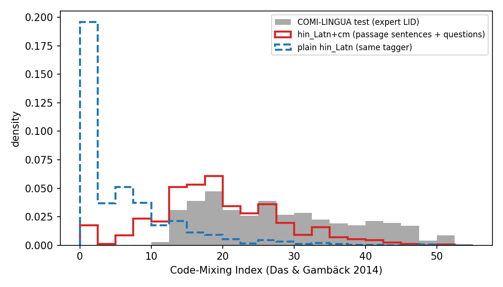

# Machine-made Hinglish (`hin_Latn+cm`) validation

*Exploratory condition.* Romanized Hindi-English code-mixed versions of the 300 sampled Belebele items, made by word-aligning the human romanized Hindi (`hin_Latn`) with the English original (`eng_Latn`) and substituting aligned English nouns, adjectives and light-verb complements for their Hindi counterparts; the amount of mixing per unit is drawn from the CMI distribution of COMI-LINGUA (expert-annotated real Hinglish). See `extra/README.md` for the full method and citations.

- Rows: **300**; items with at least one changed field: **99.3%**; fields changed: **55.2%**; tokens substituted per item (mean): 16.2
- Options distinct in every row: True; option fields reverted to hin_Latn because of a collision: 0
- Items flagged (LaBSE(cm, hin_Latn) < 0.85 in any field): **234**. Caution: LaBSE is weak on romanized Hindi (mean cos(hin_Latn, English) is only about 0.48), and swapping words for English ones moves the embedding toward English, so this flag is noisy and over-triggers; the more informative check is the next line.
- Fields where cm is *closer* to the English original than plain hin_Latn is: 98.9% of changed fields; fields where cm is more than 0.05 *farther* from English than hin_Latn (possible meaning drift): 1 in 1 items (flag `flag_drift_vs_eng`)

## CMI distribution vs COMI-LINGUA

CMI = 100 x (1 - max_i w_i / (n - u)) per unit (Das & Gambäck 2014). Units: a sentence of a passage, the question, or one option. Reference: 4,995 COMI-LINGUA LID test sentences (token tags = majority of 3 annotators; per-annotator rows shown for spread). Our tags come from alignment provenance, not annotators (see README), so absolute values are comparable only approximately.

| set | n | mean | sd | q05 | q10 | q25 | q50 | q75 | q90 | q95 | share_zero |
|---|---|---|---|---|---|---|---|---|---|---|---|
| COMI-LINGUA test, majority LID (all) | 4995 | 27.838 | 10.352 | 13.636 | 15.000 | 19.048 | 26.316 | 35.294 | 43.750 | 46.667 | 0.000 |
| COMI-LINGUA, annotator 1 | 4995 | 29.317 | 10.346 | 14.286 | 15.874 | 20.833 | 28.571 | 37.500 | 44.444 | 47.059 | 0.000 |
| COMI-LINGUA, annotator 2 | 4995 | 26.665 | 10.228 | 13.333 | 14.815 | 18.182 | 25.000 | 33.333 | 42.857 | 46.500 | 0.000 |
| COMI-LINGUA, annotator 3 | 4995 | 27.096 | 10.026 | 13.333 | 15.000 | 19.048 | 25.000 | 33.333 | 42.857 | 46.154 | 0.000 |
| COMI-LINGUA, Latin-script-dominant subset | 801 | 26.662 | 10.051 | 13.636 | 15.000 | 18.750 | 25.000 | 33.333 | 42.857 | 45.833 | 0.000 |
| Ours: passage sentences + questions (>=8 tokens), after | 1553 | 19.297 | 8.849 | 5.556 | 9.259 | 14.286 | 18.519 | 25.000 | 30.769 | 35.294 | 0.044 |
| Ours: same units, BEFORE (plain hin_Latn, same tagger) | 1553 | 5.444 | 7.376 | 0.000 | 0.000 | 0.000 | 2.778 | 8.333 | 15.000 | 20.333 | 0.482 |
| Ours: all units incl. options, after | 2876 | 16.931 | 13.073 | 0.000 | 0.000 | 5.556 | 16.667 | 25.000 | 33.333 | 40.000 | 0.247 |
| Ours: all units incl. options, BEFORE | 2876 | 5.567 | 10.167 | 0.000 | 0.000 | 0.000 | 0.000 | 7.692 | 18.182 | 28.571 | 0.622 |
| Ours: target CMI drawn for the units (all) | 2876 | 27.848 | 10.549 | 13.333 | 15.000 | 18.750 | 26.316 | 35.714 | 43.750 | 47.059 | 0.000 |
| Ours: ceiling = CMI if every candidate were substituted (sentences+questions) | 1553 | 22.921 | 10.877 | 5.556 | 9.524 | 15.385 | 22.727 | 30.000 | 37.500 | 41.667 | 0.044 |

Two-sample Kolmogorov-Smirnov statistic D (0 = identical distributions):

| set | KS_D | p_value | n |
|---|---|---|---|
| after: sentences+questions vs COMI (all) | 0.313 | 0.000 | 1553 |
| before: sentences+questions vs COMI (all) | 0.840 | 0.000 | 1553 |
| after: sentences+questions vs COMI Latin-dominant | 0.265 | 0.000 | 1553 |
| after: all units vs COMI (all) | 0.349 | 0.000 | 2876 |
| before: all units vs COMI (all) | 0.828 | 0.000 | 2876 |
| after: units with mixing reachable (n_candidates>=1), >=8 tokens, vs COMI | 0.302 | 0.000 | 1585 |
| target draws vs COMI (sanity) | 0.017 | 0.648 | 2876 |

Note: COMI-LINGUA's test split consists of sentences that are code-mixed (no sentence has CMI = 0; minimum about 7.7), so the target is a *mixed-only* distribution. Units for which the aligned English counterparts offer too few safe candidates stay below their target (see `n_candidates` in `cm_units.csv`), and option-length units have coarse CMI values (e.g. 1 of 4 words English = 25).

Sensitivity (`python -m extra.cm_sensitivity` -> `cm_sensitivity.csv`): dropping the alignment-confidence filter entirely raises the mean realised CMI of sentences+questions only from about 19.3 to 20.6 (ceiling 22.9 -> 25.2; COMI-LINGUA 27.8), so the binding constraint is the number of safe single-token substitution slots, not the filter. The method cannot reach COMI-LINGUA's level of mixing without also switching function words or multi-word phrases, which this simplified version deliberately does not do.

## Text similarity (LaBSE, `sentence-transformers/LaBSE`)

| field | fraction changed | mean edit ratio vs hin_Latn | mean cos(cm, eng) | mean cos(hin_Latn, eng) | mean cos(cm, hin_Latn) | min cos(cm, hin_Latn) | n < 0.85 |
|---|---|---|---|---|---|---|---|
| flores_passage | 0.987 | 0.1392 | 0.7075 | 0.5500 | 0.8735 | 0.6069 | 102 |
| question | 0.757 | 0.1090 | 0.6207 | 0.5128 | 0.8858 | 0.5955 | 100 |
| mc_answer1 | 0.383 | 0.0997 | 0.5636 | 0.4580 | 0.8867 | 0.2796 | 87 |
| mc_answer2 | 0.387 | 0.1007 | 0.5619 | 0.4618 | 0.8854 | 0.4172 | 98 |
| mc_answer3 | 0.413 | 0.0936 | 0.5473 | 0.4484 | 0.8892 | 0.3297 | 97 |
| mc_answer4 | 0.387 | 0.0879 | 0.5526 | 0.4587 | 0.8909 | 0.3455 | 90 |
| ALL | 0.552 | 0.1050 | 0.5923 | 0.4816 | 0.8853 | 0.2796 | 574 |

Substitutions by rule: {"noun_adj": 3597, "function_switch": 1014, "light_verb_kar": 260}

## Three random examples (seeded pick)

### `https://en.wikivoyage.org/wiki/Visa#1` (23 substitutions)

- **flores_passage**
  - English: Registration is an additional requirement for the visa process. In some countries, you must register your presence and address where you are staying with the local authorities. This might require filling out a form with the local police or a visit to the immigration offices. In many countries with such a law, local hotels will handle the registration (make sure to ask). In other cases, only those staying outside of tourist accommodations need to register.  However, this makes the law much more obscure, so find out beforehand.
  - hin_Latn (human): Visa prakriya ke liye panjikaran ek atirikt aavashyakta hai. kuch deshon mein, aapko apni upaisthiti aur pata panjikrit karna hoga jahan aap asthaaniya adhikariyon ke saath rah rahe hain. iske liye asthaaniya police ke paas ek form bharne ke yaa aapravaasan karyalayon mein jaane aavashyakta pad sakti hai. is tarah ke kanoon waale kayee deshon mein, asthaaniya hotel panjikaran sambhal lenge (poochana sunishchit karein). dusre mamalon mein, sirf aise logon ko register karne ke zarurat hai jo paryatakon ke thaharne ke jagahon se alag kahin ruke hain. haalaanki, yah baat kanoon ko zyaada ajib banaati hai, isliye pehle hi jaankari joota lain.
  - hin_Latn+cm: Visa prakriya ke liye registration ek additional aavashyakta hai. some countries mein, aapko apni presence and pata panjikrit karna hoga jahan aap asthaaniya authorities ke saath rah rahe hain. iske liye asthaaniya police ke paas ek form bharne ke or aapravaasan offices mein jaane aavashyakta pad sakti hai. is tarah ke law waale kayee deshon mein, asthaaniya hotel panjikaran sambhal lenge (poochana sunishchit karein). dusre mamalon mein, only aise logon ko register karne ke zarurat hai jo tourist ke thaharne ke jagahon se alag kahin ruke hain. haalaanki, yah baat kanoon ko zyaada obscure banaati hai, so pehle hi jaankari joota lain.
  - substitutions: panjikaran->registration, atirikt->additional, kuch->some, deshon->countries, upaisthiti->presence, aur->and, adhikariyon->authorities, yaa->or, karyalayon->offices, kanoon->law, sirf->only, paryatakon->tourist, ajib->obscure, isliye->so
- **question**
  - English: Based on the passage, which statement regarding the registration requirement for the visa process is not true?
  - hin_Latn (human): Passage ke hisab se, Visa prakriya ke lie panjikaran aavashyakta ke sambandh mein kaun sa kathan satya nahin hai?
  - hin_Latn+cm: Passage ke hisab se, Visa process ke lie registration aavashyakta ke sambandh mein kaun sa kathan satya nahin hai?
  - substitutions: prakriya->process, panjikaran->registration
- **mc_answer1**
  - English: If you’re staying in tourist accommodations, you might not need to register
  - hin_Latn (human): Agar aap paryatakon ke thaharne ki jagah mein hain toh apko register karne ki zarurat nahi hogi
  - hin_Latn+cm: Agar aap tourist ke thaharne ki accommodations mein hain toh apko register karne ki zarurat nahi hogi
  - substitutions: paryatakon->tourist, jagah->accommodations
- **mc_answer2**
  - English: All countries require registration with the local authorities
  - hin_Latn (human): Sabhi deshon ko asthaaniya adhikariyon ke saath panjikaran ki aavashyakta hai
  - hin_Latn+cm: All countries ko asthaaniya adhikariyon ke saath panjikaran ki aavashyakta hai
  - substitutions: Sabhi->All, deshon->countries
- **mc_answer3**
  - English: A visit to immigration offices might be required
  - hin_Latn (human): Aapravaasan karyalayon mein jaane ki aavashyakta pad sakti hai
  - hin_Latn+cm: Aapravaasan offices mein jaane ki aavashyakta pad sakti hai
  - substitutions: karyalayon->offices
- **mc_answer4**
  - English: In some places, local hotels can handle the registration
  - hin_Latn (human): kuch sthaano mein, asthaaniya hotel panjikaran sambhal lenge
  - hin_Latn+cm: some sthaano mein, asthaaniya hotel registration sambhal lenge
  - substitutions: kuch->some, panjikaran->registration

### `https://en.wikivoyage.org/wiki/Flying_to_Africa#1` (18 substitutions)

- **flores_passage**
  - English: Airlines such as Emirates, Etihad Airways, Qatar Airways & Turkish Airlines have greatly expanded their services to Africa, and offer connections to many major African cities at competitive rates than other European airlines. Turkish Airlines flies to 39 destinations in 30 African countries as of 2014. If you have additional travel time, check to see how your total fare quote to Africa compares with a round-the-world fare. Don't forget to add in the extra costs of additional visas, departure taxes, ground transportation, etc. for all those places outside of Africa.
  - hin_Latn (human): Amirat, itihad airways, cuttar airways aur turkish airlines jaisi airlinesne apni sevaaon ko arinka mein kain baayan hai. saath hi, doosri european airlines ke tulna mein arinka ke kayee mukhya shaharon ke beach sastee daron par flight chalaai hain. Turke airlines 2014se 30 african deshon mein 39 gantavyon ke liye udan bharati hai. Agar aapke paas yatra karne ke liye zyada samay hai, toh yah tulna karke dekhein ki africa ke yatra ke kiraaye aur world-taur ke kiraaye mein kitna antara hai. Africa ke baahar una sabhi asthanon ke liye atirikt veean, prasthaan kar, bhoomi parivahan, aadi ke atirikt laagat jodana naa bhoolen.
  - hin_Latn+cm: Amirat, itihad airways, cuttar airways aur turkish airlines jaisi airlinesne apni services ko arinka mein kain baayan hai. saath hi, doosri european airlines ke tulna mein arinka ke kayee major cities ke beach sastee daron par flight chalaai hain. Turke airlines 2014se 30 african countries mein 39 gantavyon ke liye udan bharati hai. Agar aapke paas travel karne ke liye zyada time hai, toh yah tulna karke dekhein ki africa ke yatra ke kiraaye aur world-taur ke kiraaye mein kitna antara hai. Africa ke baahar una all places ke liye additional veean, prasthaan kar, ground transportation, aadi ke atirikt costs jodana naa bhoolen.
  - substitutions: sevaaon->services, mukhya->major, shaharon->cities, deshon->countries, yatra->travel, samay->time, sabhi->all, asthanon->places, atirikt->additional, bhoomi->ground, parivahan->transportation, laagat->costs
- **question**
  - English: What does not need to be added in while comparing a total fare quote to Africa with a round-the-world fare?
  - hin_Latn (human): africa ke yatra ke kiraaye aur world-taur ke kiraaye mein tulna karte samay kya jodna nahi bhoolna chahiye?
  - hin_Latn+cm: africa ke yatra ke kiraaye aur world-taur ke kiraaye mein tulna karte while kya jodna nahi bhoolna chahiye?
  - substitutions: samay->while
- **mc_answer1**
  - English: Cost of additional visas for places outside of Africa
  - hin_Latn (human): Africa ke baahar una sabhi asthanon ke liye visa ka atirikt kharch
  - hin_Latn+cm: Africa ke baahar una sabhi places ke liye visa ka atirikt cost
  - substitutions: asthanon->places, kharch->cost
- **mc_answer2**
  - English: Cost of the departure taxes in Africa
  - hin_Latn (human): Africa se prasthaan kar ka kharch
  - hin_Latn+cm: Africa se departure kar ka kharch
  - substitutions: prasthaan->departure
- **mc_answer3**
  - English: Cost of an African visa
  - hin_Latn (human): Africa ke visa ka kharch
  - hin_Latn+cm: Africa ke visa ka cost
  - substitutions: kharch->cost
- **mc_answer4**
  - English: Cost of ground transportation for locations outside of Africa
  - hin_Latn (human): Africa se bahar ki jagahon ka bhoomi parivahan ka kharch
  - hin_Latn+cm: Africa se bahar ki jagahon ka bhoomi parivahan ka cost
  - substitutions: kharch->cost

### `https://en.wikivoyage.org/wiki/Noum%C3%A9a#2` (9 substitutions)

- **flores_passage**
  - English: "The main local beer is 'Number One', it is not a complex beer, but pleasant and refreshing. The other local beer is called ""Manta"". There are many French wines to be had, but the New Zealand and Australian wines might travel better. The local tap water is perfectly safe to drink, but bottled water is easy to find if you are fearful. For Australians, the idea of 'flat white' coffee is foreign. A short black is 'espresso', cappuccino comes heaped high with cream (not froth), and tea is served without milk. The hot chocolate is up to Belgian standards. Fruit juices are pricey but excellent."
  - hin_Latn (human): "Mukhya local bear 'number one' hai, yah ek complexes bear nahin hai, balki yah aapko tajgi detee hai. any local bear ko ""manta"" kahaa jaataa hai. Yahaan kayee tarah ke french wine milti hain, lekin shayed newzealand aur Australia ke wine behtar hogi. Sthaaniya null ka paani peene ke liye ekdam surakshit hai, lekin yadi aapko darr hai toh bottle band paani aasaanise mill jaataa hai. Australia ke logon ke liye, 'flat white' coffee ka vichaar videshi hai.short blek 'espresso' hai, capechino mein cream (jhaag nahin) bharaa hota hai, aur chaya doodh ke binaa parosi jaati hai. Hot chocolate belgium ke manakon par bany hai. falon ka juice mahanga hai lekin bahut achcha hai."
  - hin_Latn+cm: "Main local bear 'number one' hai, yah ek complexes bear nahin hai, balki yah aapko tajgi detee hai. any local bear ko ""manta"" kahaa jaataa hai. Yahaan kayee tarah ke french wine milti hain, but shayed newzealand and Australia ke wine behtar hogi. Sthaaniya null ka paani peene ke liye ekdam surakshit hai, lekin yadi aapko fearful hai toh bottle band water easy mill jaataa hai. Australia ke logon ke liye, 'flat white' coffee ka vichaar videshi hai.short blek 'espresso' hai, capechino mein cream (jhaag nahin) bharaa hota hai, aur chaya doodh ke binaa parosi jaati hai. Hot chocolate belgium ke manakon par bany hai. falon ka juice pricey hai but bahut achcha hai."
  - substitutions: Mukhya->Main, lekin->but, aur->and, darr->fearful, paani->water, aasaanise->easy, mahanga->pricey, lekin->but
- **question**
  - English: Based on the area described in the passage, which of the following beverage orders is likely to be confused by a server?
  - hin_Latn (human): Passage mein bataye gaye ilaake ke anusaar, inmein se kaunsa pey sever ko uljhan mein daal sakta hai?
  - hin_Latn+cm: Passage mein bataye gaye area ke anusaar, inmein se kaunsa pey sever ko uljhan mein daal sakta hai?
  - substitutions: ilaake->area
- **mc_answer1**
  - English: A short black
  - hin_Latn (human): Short black
  - hin_Latn+cm: Short black
  - substitutions: (none)
- **mc_answer2**
  - English: A Number One
  - hin_Latn (human): Number one
  - hin_Latn+cm: Number one
  - substitutions: (none)
- **mc_answer3**
  - English: A Sauvignon Blanc from New Zealand
  - hin_Latn (human): New Zealand se Sauvignon Blanc
  - hin_Latn+cm: New Zealand se Sauvignon Blanc
  - substitutions: (none)
- **mc_answer4**
  - English: A flat white
  - hin_Latn (human): Flat white
  - hin_Latn+cm: Flat white
  - substitutions: (none)
